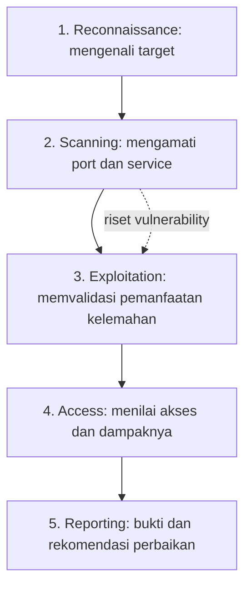

# Ethical Hacking untuk Pemula — Catatan Video dan Penjelasan Konsep

Panduan pemula berbahasa Indonesia yang menjelaskan **network reconnaissance, Nmap, SMB, MS17-010/EternalBlue, Metasploit, shell, privilege, dan reporting** dari sebuah demonstrasi latihan penetration testing.

> **Sumber demonstrasi:** [How To Learn Hacking — A Practical Demo (YouTube)](https://youtu.be/uPbQNFuDGUs)  
> **Lab yang digunakan dalam video:** [TryHackMe — Blue](https://tryhackme.com/room/blue)  
> **Cakupan transkrip yang tersedia:** 00:00–24:33. Bagian reporting pada transkrip berhenti sebelum penjelasannya selesai.  
> **Bahasa:** Indonesia | **Audiens:** pemula | **Disusun:** 18 Oktober 2026

## Daftar isi

1. [Tujuan dan etika belajar](#1-tujuan-dan-etika-belajar)
2. [Gambaran besar proses pentesting](#2-gambaran-besar-proses-pentesting)
3. [Istilah jaringan: IP, port, protocol, service](#3-istilah-jaringan-ip-port-protocol-service)
4. [Menyiapkan laboratorium TryHackMe](#4-menyiapkan-laboratorium-tryhackme)
5. [Reconnaissance dan scanning dengan Nmap](#5-reconnaissance-dan-scanning-dengan-nmap)
6. [Vulnerability research: SMB dan MS17-010](#6-vulnerability-research-smb-dan-ms17-010)
7. [Exploitation dengan Metasploit: konsepnya](#7-exploitation-dengan-metasploit-konsepnya)
8. [Shell, Meterpreter, privilege, dan CTF flag](#8-shell-meterpreter-privilege-dan-ctf-flag)
9. [Reporting dan mitigasi](#9-reporting-dan-mitigasi)
10. [Latihan dasar yang aman](#10-latihan-dasar-yang-aman)
11. [Kesalahan umum dan klarifikasi video](#11-kesalahan-umum-dan-klarifikasi-video)
12. [FAQ dan glossary](#12-faq-dan-glossary)
13. [Sumber dan bahan belajar lanjutan](#13-sumber-dan-bahan-belajar-lanjutan)

## 1. Tujuan dan etika belajar

Dokumen ini dibuat untuk menjelaskan **bagaimana proses ethical hacking bekerja**, bukan memberikan izin untuk menyerang sistem publik.

**Aturan dasarnya:** uji hanya komputer, aplikasi, dan jaringan yang **dimiliki atau secara eksplisit diizinkan** untuk diuji. Pada bug bounty, patuhi scope, kebijakan program, serta pembatasan teknik dan lalu lintas. Hindari tindakan yang mengganggu ketersediaan layanan atau mengakses data pihak lain tanpa izin.

Contoh target pembelajaran yang tepat:

- `127.0.0.1`: komputer sendiri melalui alamat loopback.
- VM/lab lokal yang sengaja disiapkan.
- Target yang diberikan oleh TryHackMe dalam room aktif.
- Aset bug bounty yang **secara eksplisit termasuk scope** dan mengizinkan metode yang hendak digunakan.

IP dalam dokumen seperti `10.10.50.8` **hanya ilustrasi**, bukan target tetap atau IP dari video yang harus ditiru.

## 2. Gambaran besar proses pentesting

Video menyajikan lima fase:



| Fase | Pertanyaan utamanya | Ilustrasi dari video |
| --- | --- | --- |
| Reconnaissance | Apa yang boleh diuji? Kita sedang berhadapan dengan sistem apa? | Menerima IP target Windows dari TryHackMe |
| Scanning | Port dan service apa yang terdeteksi? | Nmap mengidentifikasi TCP 445/SMB |
| Vulnerability research* | Apakah versi/implementasi layanan memiliki kelemahan yang relevan? | SearchSploit, riset MS17-010, script NSE |
| Exploitation | Apakah kelemahan yang ditemukan dapat dimanfaatkan dalam lab? | Demonstrasi Metasploit/EternalBlue |
| Access | Session dan privilege apa yang berhasil diperoleh? | Shell, Meterpreter, SYSTEM, flag CTF |
| Reporting | Apa risiko dan bagaimana memperbaikinya? | Rangkuman bukti, dampak, rekomendasi |

\* Video memasukkan riset vulnerability di antara scanning dan exploitation; itu berguna dipahami sebagai aktivitas khusus meskipun bukan salah satu dari lima judul fase pembuka.

Dalam pekerjaan nyata, fase bisa berulang. Tidak setiap pengujian harus menjalankan exploit; metode pembuktian perlu disesuaikan dengan otorisasi dan risiko.

## 3. Istilah jaringan: IP, port, protocol, service

### 3.1. IP address

IP address adalah alamat untuk mengidentifikasi tujuan komunikasi di jaringan. Contoh:

```text
192.168.1.10   # contoh IP private lokal
10.10.50.8     # contoh IP private lain, BUKAN IP wajib video
127.0.0.1      # loopback: perangkat itu sendiri
```

Ketika TryHackMe menjalankan mesin lab, platform menampilkan IP khusus mesin tersebut. **Gunakan IP yang diberikan room pada sesi masing-masing**, bukan menebak IP atau mengambil IP publik acak.

### 3.2. Port

Port adalah nomor endpoint komunikasi dalam protokol transport seperti TCP dan UDP. Satu IP dapat memiliki beberapa layanan di port yang berbeda.

| Port umum | Service/protocol yang sering digunakan | Fungsi |
| --- | --- | --- |
| 22/TCP | SSH | Akses remote yang aman |
| 80/TCP | HTTP | Aplikasi web |
| 443/TCP | HTTPS | Aplikasi web dengan TLS |
| 445/TCP | SMB | Berbagi file/printer pada Windows |
| 3306/TCP | MySQL | Layanan database |
| 3389/TCP | RDP | Remote Desktop Windows |

Nomor port yang umum **bukan bukti pasti** bahwa service tertentu benar-benar berjalan di sana. Administrator bisa mengubah port.

### 3.3. Kenapa video memilih port 445, bukan SSH?

Video menguji kelemahan **Windows SMBv1** yang dapat diakses melalui layanan SMB (umumnya TCP 445). Exploit yang ditunjukkan disebut **EternalBlue**, terkait bulletin **MS17-010**.

SSH berbeda: protokol login jarak jauh, sering di port 22. Login SSH secara normal memerlukan autentikasi; tidak ada alasan menggunakan SSH untuk menguji bug yang khusus berada pada SMB. Bisa jadi target bahkan tidak menjalankan SSH.

**Port terbuka ≠ vulnerable.** Yang perlu diperiksa adalah software/protokol, versi, patch, konfigurasi, dan kondisi target.

### 3.4. Apa bedanya IP, port, dan service?

Analogi sederhana:

- **IP** = alamat gedung.
- **Port** = nomor pintu layanan.
- **Service** = petugas atau kegiatan di balik pintu.
- **Protocol** = aturan bagaimana dua pihak berkomunikasi.

Analogi ini membantu, tetapi port sebenarnya bukan pintu fisik.

## 4. Menyiapkan laboratorium TryHackMe

Video menggunakan **TryHackMe** agar semua aktivitas berlangsung pada mesin yang sengaja dibuat untuk latihan.

Dua istilah penting:

| Istilah | Maksud |
| --- | --- |
| **AttackBox** | Mesin virtual penguji, umumnya Linux, berisi tools keamanan |
| **Target machine** | Mesin lab Windows yang sengaja menyediakan tantangan vulnerability |

```text
Browser kita
  ├── membuka AttackBox (menjalankan Nmap, Metasploit, terminal)
  └── membuka halaman room Blue
                  │
                  ▼
            Target VM Windows
```

**Langkah umum sesuai video:** buka [TryHackMe](https://tryhackme.com/), masuk ke room [Blue](https://tryhackme.com/room/blue), mulai target VM dan AttackBox, lalu catat IP target yang muncul di halaman. Antarmuka dan batas pemakaian gratis dapat berubah menurut kebijakan platform.

AttackBox berjalan di lingkungan yang disediakan TryHackMe. **Tools di AttackBox tidak otomatis terinstal di laptop pribadi.**

Terminal menjalankan command melalui shell, misalnya:

```bash
whoami
```

Ini memperlihatkan identitas user pada **mesin tempat command dijalankan** (misalnya AttackBox), bukan otomatis identitas user di target.

## 5. Reconnaissance dan scanning dengan Nmap

### 5.1. Apa itu reconnaissance?

Recon adalah pengumpulan informasi untuk memahami target dan scope. Dalam video, informasi awal berupa IP mesin Windows yang sudah disediakan.

### 5.2. Apa itu Nmap?

[Nmap](https://nmap.org/) (*Network Mapper*) adalah tool untuk mengamati host, port, dan service pada jaringan. Ia bukan tool yang dapat otomatis masuk ke semua komputer.

**Bentuk umum command:**

```bash
nmap [OPSI] [TARGET]
```

- `nmap` = nama program.
- `[OPSI]` = argumen/flag untuk mengubah perilaku program.
- `[TARGET]` = IP/domain/host yang diizinkan diuji.

### 5.3. Memahami flag: `-sV`, `-sC`, dan `-p`

| Command aman pada loopback | Penjelasan |
| --- | --- |
| `nmap 127.0.0.1` | Scan port umum pada komputer sendiri |
| `nmap -sV 127.0.0.1` | **Service/version detection** (`s` kecil, `V` besar) |
| `nmap -sC 127.0.0.1` | Menjalankan **default Nmap Scripting Engine scripts** |
| `nmap -sV -sC 127.0.0.1` | Deteksi versi + default scripts |
| `nmap -p 445 127.0.0.1` | Hanya memeriksa port 445 |
| `nmap -p 22,80,443 127.0.0.1` | Memeriksa tiga port tertentu |

`-sV` mencoba mengenali software/versi melalui respons layanan; hasilnya tidak selalu pasti. `-sC` menjalankan sejumlah script default, **bukan seluruh vulnerability scanner**. Sebagian script bisa bersifat intrusif, sehingga gunakan hanya dalam lingkungan yang memiliki izin.

**Catatan:** `-sV` tidak sama dengan `-sF`. `-sF` berarti *TCP FIN scan*; penulisan itu muncul keliru dalam transkrip otomatis video.

### 5.4. Cara membaca hasil Nmap

Contoh output **ilustratif, bukan hasil live**:

```text
PORT     STATE    SERVICE
22/tcp   open     ssh
445/tcp  open     microsoft-ds
```

- `PORT`: nomor port serta protokol transport.
- `STATE`: kondisi yang disimpulkan scanner (`open`, `closed`, `filtered`, dan sebagainya).
- `SERVICE`: nama layanan yang dipetakan/diidentifikasi.

Jika `445/tcp` terbuka, kita dapat menyelidiki layanan SMB tersebut lebih lanjut. Itu belum membuktikan vulnerability.

**Hal lain yang perlu diketahui:** scan default Nmap tidak otomatis mencakup seluruh rentang 65.535 port TCP. Biasanya memeriksa 1.000 port TCP paling umum.

### 5.5. Apa yang terjadi di balik layar?

Untuk sebagian jenis pemeriksaan TCP, scanner mengirim paket jaringan lalu menilai respons target. Pada TCP SYN scan terhadap port yang terbuka, respons yang umum adalah `SYN/ACK`. Firewalls dapat membuat suatu port tampak `filtered` atau mengubah respons yang terlihat.

## 6. Vulnerability research: SMB dan MS17-010

### 6.1. Apa itu SMB?

**SMB (Server Message Block)** adalah protokol yang memungkinkan layanan seperti berbagi file atau printer melalui jaringan. Windows telah lama menggunakannya.

### 6.2. Dari service ke kandidat vulnerability

Alur penalaran video:

```text
Nmap menemukan Windows SMB pada port 445
                  ↓
Mencari kelemahan yang diketahui untuk service terkait
                  ↓
Muncul referensi MS17-010 / EternalBlue
                  ↓
Menjalankan pemeriksaan khusus di lab
                  ↓
Menilai apakah target menunjukkan indikasi vulnerability
```

Video memperkenalkan **SearchSploit**, tool untuk mencari referensi exploit dari database lokal Exploit-DB. Hasil pencarian adalah **kandidat**, bukan bukti bahwa setiap exploit cocok dengan target.

### 6.3. Perbedaan istilah

| Istilah | Makna |
| --- | --- |
| Bug | Kesalahan perilaku/implementasi software |
| Vulnerability | Kelemahan yang berdampak pada keamanan |
| CVE | Identitas standar untuk vulnerability yang tercatat |
| MS17-010 | Bulletin keamanan Microsoft untuk beberapa kelemahan SMBv1 |
| EternalBlue | Nama exploit terkenal yang memanfaatkan kelemahan SMB tertentu |
| RCE | *Remote Code Execution*: eksekusi kode melalui jalur dari jarak jauh |
| Payload | Kode/aksi yang diharapkan berjalan setelah exploit berhasil |

Microsoft menerbitkan **MS17-010 pada 14 Maret 2017**. Bulletin ini menjelaskan bahwa pesan SMBv1 yang dibuat secara khusus dapat memicu kelemahan berisiko *remote code execution* pada sistem rentan. Vulnerability terkait EternalBlue kemudian dikenal luas karena disalahgunakan dalam penyebaran WannaCry.

### 6.4. Pemeriksaan MS17-010 dengan NSE

Nama script yang benar adalah `smb-vuln-ms17-010`, bukan bentuk yang terdengar berbeda dalam transkrip otomatis.

```bash
# Contoh sintaks khusus target lab/izin eksplisit; bukan IP publik sembarangan
nmap -p445 --script smb-vuln-ms17-010 <IP_TARGET_LAB>
```

- `-p445`: fokus pada TCP port 445.
- `--script`: memilih script NSE tertentu.
- `smb-vuln-ms17-010`: memeriksa ciri-ciri SMBv1 yang terkait MS17-010.

Jika hasil menyebut `VULNERABLE`, itu **indikasi berdasarkan respons target**, bukan garansi eksploit akan berhasil. Rujuk [dokumentasi resmi NSE](https://nmap.org/nsedoc/scripts/smb-vuln-ms17-010.html) untuk persyaratan dan interpretasi.

## 7. Exploitation dengan Metasploit: konsepnya

[Metasploit Framework](https://docs.metasploit.com/) menyediakan berbagai modul keamanan untuk pengujian, di antaranya modul *exploit*, *auxiliary*, *payload*, dan *post*.

Video menggunakan Metasploit dalam lab untuk menguji kelemahan yang telah diidentifikasi.

| Istilah/opsi Metasploit | Fungsi |
| --- | --- |
| `msfconsole` | Antarmuka command-line Metasploit |
| Exploit module | Modul yang mencoba memanfaatkan bug spesifik |
| `RHOSTS` | IP/host remote target |
| `LHOST` | Alamat mesin penguji yang menerima koneksi balik pada konfigurasi reverse payload |
| `check` | Pemeriksaan awal jika modul mendukungnya |
| `exploit` | Menjalankan modul yang sudah dikonfigurasi |
| Session | Kanal komunikasi yang berhasil dibuka dengan target |

### 7.1. Kenapa perlu RHOSTS dan LHOST?

Misalnya dalam **ilustrasi jaringan lab**:

```text
AttackBox: 10.10.20.5         Target Windows: 10.10.50.8
     (LHOST)                         (RHOSTS)
        │                                ▲
        └──── koneksi balik payload ────┘
```

Dalam *reverse connection*, setelah payload berhasil berjalan, target membuka koneksi ke alamat yang disiapkan penguji. Alamat `LHOST` perlu dapat dijangkau target. Nama antarmuka VPN seperti `tun0` dapat muncul di Linux; perintah `ip a` memperlihatkan alamat interface.

Contoh IP di atas **bukan IP asli yang diwajibkan lab**.

### 7.2. Mengapa exploitation tidak selalu berhasil?

- Target mungkin telah dipatch.
- Versi/arsitektur sistem tidak cocok.
- Port tidak dapat dijangkau karena jaringan atau firewall.
- Payload tidak berhasil berjalan atau tidak bisa membuka koneksi.
- Proses target crash/menjadi tidak stabil.

Karena itulah pengujian exploit perlu izin, pengendalian risiko, dan dokumentasi. **Dokumen ini menjelaskan rangkaian video tanpa menjadikan exploit terhadap host acak sebagai langkah praktik.**

## 8. Shell, Meterpreter, privilege, dan CTF flag

### 8.1. Shell vs Meterpreter

**Shell** adalah lingkungan menjalankan perintah pada OS. **Meterpreter** adalah jenis payload/session khusus Metasploit yang menyediakan fungsi pengujian tambahan. Memiliki session tidak otomatis berarti memiliki hak administrator atau akses tanpa batas.

### 8.2. Memeriksa identitas dan privilege

Pada shell Linux/Windows, command `whoami` lazim digunakan untuk melihat identitas user saat ini. Pada Meterpreter, tersedia perintah seperti `getuid`.

Di video dibahas hasil `NT AUTHORITY\SYSTEM` — akun Windows dengan hak sangat tinggi pada mesin lokal. Namun, hak SYSTEM tidak berarti semua kredensial pasti mudah diakses karena masih ada mekanisme proteksi lain.

**Privilege escalation** berarti usaha memperoleh hak akses lebih tinggi daripada sebelumnya. Exploit tertentu dapat memberi hak tinggi langsung; pada kasus lain tidak.

### 8.3. Process migration

Video memperkenalkan daftar proses (misalnya `ps` pada Meterpreter) dan gagasan *migrasi session* ke proses yang berjalan. Ini bukan prosedur wajib dan **tidak menjamin session akan stabil atau tidak terputus**.

### 8.4. CTF flag

*Flag* dalam Capture The Flag adalah string yang sengaja ditempatkan oleh pembuat lab sebagai bukti penyelesaian tantangan.

```text
THM{CONTOH_BUKAN_FLAG_ASLI}
```

Jangan samakan *CTF flag* (string jawaban) dengan *command-line flag* seperti `-sV` (opsi program).

### 8.5. Ada ketidakkonsistenan narasi session di video

Bagian awal exploitation dalam transkrip menyebut Meterpreter langsung terbuka; bagian berikutnya justru menjelaskan upgrade shell biasa menjadi Meterpreter. Petunjuk resmi [TryHackMe Blue](https://tryhackme.com/room/blue) mencontohkan **shell → konversi ke Meterpreter**. Karena itu, hasil session yang aktual harus dibaca sebelum memilih langkah selanjutnya. Bisa jadi sebagian perbedaan berasal dari penyederhanaan video atau transkrip.

## 9. Reporting dan mitigasi

Penekanan akhir video: kemampuan menemukan kelemahan baru berguna bagi pemilik sistem jika hasilnya disampaikan dengan jelas.

**Batas sumber:** transkrip video yang tersedia berakhir pada menit 24:33 di tengah uraian reporting. Bagian template di bawah adalah **penjelasan tambahan**, bukan isi detail yang seluruhnya terlihat dalam transkrip.

### 9.1. Template laporan sederhana

```markdown
# Security Finding: <Judul vulnerability>

## Ringkasan
Apa yang ditemukan dan mengapa penting?

## Scope / Aset
Aset apa yang secara sah diuji?

## Bukti
Apa output atau observasi yang menunjukkan masalah?

## Dampak
Risiko terhadap kerahasiaan, integritas, dan ketersediaan?

## Rekomendasi
Patch, konfigurasi, pembatasan akses, atau kontrol lain.

## Retest
Apa hasil pengujian ulang setelah perbaikan?
```

### 9.2. Contoh rekomendasi untuk risiko MS17-010

1. Terapkan pembaruan keamanan Windows yang relevan.
2. Nonaktifkan SMBv1 jika tidak diperlukan.
3. Batasi akses ke layanan SMB pada segmen jaringan yang membutuhkan.
4. Uji ulang untuk memastikan mitigasi benar-benar efektif.

Langkah ini bersifat umum; pengambilan keputusan di sistem produksi memerlukan inventaris aset, kompatibilitas, dan perubahan yang terkontrol.

## 10. Latihan dasar yang aman

### 10.1. Install Nmap

Download dari **[website resmi Nmap](https://nmap.org/download.html)** (Windows/macOS/Linux). Pada Windows gunakan installer resmi; di Linux dapat menggunakan package manager sesuai distro.

Contoh pada Ubuntu/Debian:

```bash
sudo apt update
sudo apt install nmap
nmap --version
```

Contoh pada macOS dengan Homebrew:

```bash
brew install nmap
nmap --version
```

### 10.2. Praktik scan pada komputer sendiri

```bash
nmap 127.0.0.1
nmap -sV 127.0.0.1
nmap -p 80,443 127.0.0.1
```

Perhatikan apa yang berubah antara perintah. Tidak ada port `open` pun bisa menjadi hasil normal jika tidak ada layanan yang berjalan pada loopback.

Untuk script scanning gunakan hanya lab sendiri/izin eksplisit:

```bash
nmap -sC 127.0.0.1
```

### 10.3. Latihan dari platform

- [TryHackMe Blue](https://tryhackme.com/room/blue): latihan Windows/SMB pada lab yang diizinkan.
- [Hacker101](https://www.hacker101.com/): kursus dan CTF untuk jalur web/bug bounty.
- [PortSwigger Web Security Academy](https://portswigger.net/web-security): keamanan HTTP dan aplikasi web.

**Catatan khusus bug bounty:** memiliki akun HackerOne bukan izin menyapu seluruh internet. Periksa scope dan aturan program sebelum menguji apa pun. Dalam bug bounty web, pemahaman HTTP, autentikasi, otorisasi, session, dan Burp Suite sering lebih langsung relevan daripada exploit SMB Windows.

## 11. Kesalahan umum dan klarifikasi video

| Pernyataan/kesan | Yang lebih akurat |
| --- | --- |
| "Open port = celah" | Open port hanya menunjukkan service tersedia untuk komunikasi |
| "Nmap pasti tahu versi software" | Nmap melakukan fingerprinting dan bisa salah/tidak lengkap |
| "`-sC` menjalankan seluruh pemeriksaan vulnerability" | `-sC` menjalankan default NSE scripts, bukan semua script |
| "Status `VULNERABLE` berarti exploit pasti sukses" | Hasil scan memberi indikasi; eksploitasi dipengaruhi kondisi lain |
| "SYSTEM selalu bisa mengakses semuanya" | SYSTEM sangat berprivilege, tetapi beberapa proteksi tetap berlaku |
| "Process migration menjamin session aman" | Tidak ada jaminan stabilitas dan ada risiko kegagalan |
| "Setiap pentest selalu linear lima langkah" | Model video menyederhanakan proses yang dalam praktik sering iteratif |
| "Gunakan IP `10.10.50.8` untuk mengikuti video" | Itu hanya **contoh ilustratif**, bukan alamat resmi target lab |

**Koreksi transkrip otomatis:**

| Di transkrip terdengar/tertulis | Istilah atau command benar |
| --- | --- |
| N MAPAP | `nmap` |
| `-sF` sebagai version detection | **`-sV`**, sementara `-sF` adalah FIN scan |
| Search Exploit | `searchsploit` |
| Metasloit | `metasploit` |
| MS17-10 | `MS17-010` |
| Meter printer | `Meterpreter` |
| Get you | `getuid` (di Meterpreter) |
| Ton zero | `tun0` |
| SMB-V-MS17-100 | `smb-vuln-ms17-010` |

## 12. FAQ dan glossary

### FAQ

**Mengapa tidak langsung mencoba SSH untuk masuk?**  
SSH adalah layanan remote login tersendiri yang umumnya memerlukan autentikasi. Video sedang memvalidasi kelemahan SMB, bukan menguji keamanan login SSH.

**Apakah semua port 445 rentan EternalBlue?**  
Tidak. Vulnerability ini bergantung pada sistem dan implementasi yang relevan, patch, konfigurasi, serta apakah layanan dapat dijangkau.

**Apa fungsi `-p` pada Nmap?**  
Memilih nomor port, misalnya `-p 445` atau `-p 80,443`.

**Perlukah Kali Linux?**  
Tidak wajib. Nmap tersedia pada berbagai OS; TryHackMe juga menyediakan AttackBox yang sudah diperlengkapi tools.

**Apa bedanya `RHOSTS` dan `LHOST`?**  
`RHOSTS` adalah target remote; `LHOST` menjadi alamat penerima koneksi sisi penguji pada skenario reverse payload yang relevan.

**Apakah mencoba exploit selalu menjadi bukti terbaik?**  
Tidak selalu. Uji eksploitasi memiliki risiko dan harus mempertimbangkan scope, dampak layanan, serta metode pembuktian yang paling aman.

### Glossary

| Istilah | Arti sederhana |
| --- | --- |
| Attacker machine | Mesin yang menjalankan alat pengujian |
| Target machine | Mesin yang diuji dan termasuk scope |
| IP address | Alamat perangkat dalam jaringan |
| TCP/UDP | Protokol transport jaringan |
| Port | Nomor endpoint layanan komunikasi |
| SSH | Protokol remote login terenkripsi |
| SMB | Protokol berbagi file/printer |
| Nmap | Tool discovery dan scanning jaringan |
| NSE | Nmap Scripting Engine |
| SearchSploit | Tool pencari referensi exploit lokal |
| Vulnerability | Kelemahan keamanan |
| Exploit | Mekanisme untuk memanfaatkan kelemahan |
| Payload | Kode/aksi setelah eksploitasi berhasil |
| RCE | Eksekusi kode jarak jauh |
| Metasploit | Framework untuk berbagai tugas pengujian keamanan |
| Shell | Antarmuka menjalankan perintah pada OS |
| Meterpreter | Payload/session khusus dalam Metasploit |
| Privilege | Hak akses akun atau proses |
| Process | Program yang sedang berjalan |
| PID | Identitas numerik proses |
| CTF flag | String bukti penyelesaian tantangan |
| Reporting | Penyusunan temuan dan rekomendasi perbaikan |

## 13. Sumber dan bahan belajar lanjutan

### Materi video yang dirangkum

1. [Video YouTube — How To Learn Hacking: A Practical Demo](https://youtu.be/uPbQNFuDGUs).
2. [TryHackMe — Blue](https://tryhackme.com/room/blue) (lingkungan lab yang digunakan).

### Dokumentasi untuk klarifikasi teknis

1. [Nmap — Service and Version Detection (`-sV`)](https://nmap.org/book/man-version-detection.html).
2. [Nmap — Nmap Scripting Engine, termasuk `-sC`](https://nmap.org/book/nse-usage.html).
3. [Nmap — Script `smb-vuln-ms17-010`](https://nmap.org/nsedoc/scripts/smb-vuln-ms17-010.html).
4. [Microsoft Security Bulletin MS17-010](https://learn.microsoft.com/en-us/security-updates/securitybulletins/2017/ms17-010).
5. [Nmap — Download dan instalasi](https://nmap.org/download.html).

### Belajar berikutnya

- [Hacker101](https://www.hacker101.com/) — dasar web security dan CTF.
- [PortSwigger Web Security Academy](https://portswigger.net/web-security) — lab keamanan aplikasi web.
- [Metasploit Documentation](https://docs.metasploit.com/) — panduan resmi Metasploit.

---

## Penutup

Pelajaran utama video ini bukan sekadar menghafal Nmap atau Metasploit, tetapi memahami alur berpikir penguji keamanan:

**Ketahui apa yang boleh diuji → kumpulkan informasi → identifikasi kelemahan → validasi secara proporsional → jelaskan dampak → bantu memperbaiki sistem.**

*Dokumen ini merupakan catatan pembelajaran yang merangkum isi video sekaligus memberikan klarifikasi teknis terpisah. Tidak ada klaim bahwa contoh output/target ilustratif merupakan hasil pemindaian nyata.*
