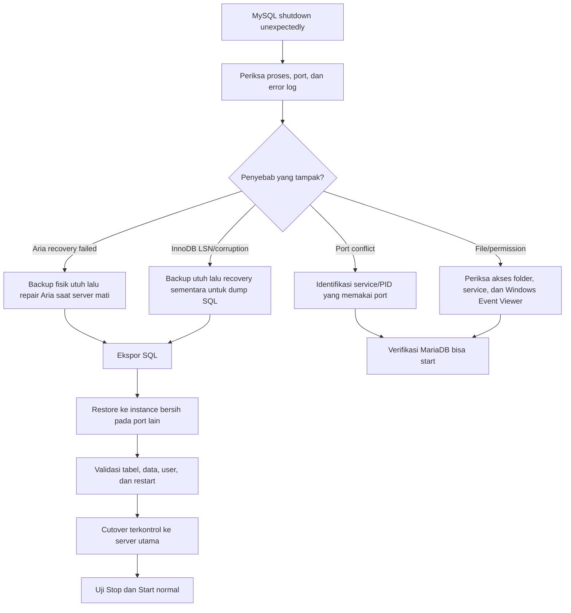

# Mengatasi “MySQL Shutdown Unexpectedly” di XAMPP — Panduan Recovery MariaDB untuk Pemula

> **Bahasa:** Indonesia · **Platform contoh:** Windows + XAMPP + MariaDB · **Level:** Pemula–menengah · **Tujuan:** diagnosis, menyelamatkan data, melakukan recovery, dan mencegah masalah berulang.
>
> **⚠️ PERINGATAN DATA:** Jangan ikuti tutorial yang menyuruh mengganti `mysql/data` dengan isi `mysql/backup`, kemudian menggabungkan `ibdata1`, folder database, dan redo log dari waktu berbeda. Itu bisa membuat MariaDB terlihat berhasil Start tetapi menyisakan ketidakkonsistenan data. **Backup dulu, pahami error log, uji restore, baru cutover.**

## Daftar isi

1. [Ringkasan cepat](#1-ringkasan-cepat)
2. [Mengenal XAMPP, MySQL, dan MariaDB](#2-mengenal-xampp-mysql-dan-mariadb)
3. [Cara membaca gejala dan error log](#3-cara-membaca-gejala-dan-error-log)
4. [Penyebab umum dan akar masalah yang sering terlewat](#4-penyebab-umum-dan-akar-masalah-yang-sering-terlewat)
5. [Prosedur recovery aman dari awal sampai selesai](#5-prosedur-recovery-aman-dari-awal-sampai-selesai)
6. [Panduan error lain dan keputusan berikutnya](#6-panduan-error-lain-dan-keputusan-berikutnya)
7. [Pencegahan dan backup rutin](#7-pencegahan-dan-backup-rutin)
8. [Glosarium istilah](#8-glosarium-istilah)
9. [Studi kasus anonim](#9-studi-kasus-anonim)
10. [Referensi resmi](#10-referensi-resmi)

---

## 1. Ringkasan cepat

Kalau XAMPP menampilkan:

```text
[mysql] Error: MySQL shutdown unexpectedly.
This may be due to a blocked port, missing dependencies,
improper privileges, a crash, or a shutdown by another method.
```

itu **hanya pesan umum dari XAMPP**. XAMPP belum memberi tahu akar masalah. Informasi yang dibutuhkan ada di **error log MariaDB**.

**Jangan langsung memindahkan/menghapus file database.** Gunakan alur:



### Aturan keselamatan terpenting

1. **Jangan** campur `ibdata1`, file `.ibd`, redo log, dan folder database dari backup berbeda.
2. **Jangan** jalankan `aria_chk` pada file yang sedang dipakai MariaDB.
3. **Jangan** gunakan `innodb_force_recovery` untuk operasi normal: itu hanya cara sementara untuk menolong proses penyelamatan data.
4. **Jangan** berasumsi `mysqldump` sukses hanya karena `.sql` terbuat. Periksa exit code, error, dan lakukan **test restore**.
5. **Jangan** copy/rename folder `data` selama ada proses `mysqld.exe`/`mariadbd.exe` berjalan.
6. **Jangan** upload backup SQL, isi `data/`, atau konfigurasi yang berisi password ke GitHub.

## 2. Mengenal XAMPP, MySQL, dan MariaDB

### Kenapa tombolnya “MySQL” padahal log berkata MariaDB?

**XAMPP** adalah paket development lokal yang biasanya menyediakan Apache, PHP, dan database. Pada banyak distribusi XAMPP, tombol **MySQL** sebenarnya menjalankan **MariaDB**, yaitu database server yang masih kompatibel dengan banyak perintah/tool MySQL. **Selalu cek versi nyata dari log atau `SELECT VERSION()`**, bukan hanya label tombol.

**Komponen yang sering tertukar:**

| Komponen | Peran | Contoh pada instalasi XAMPP Windows |
|---|---|---|
| XAMPP Control Panel | Mengendalikan Start/Stop | `xampp-control.exe` |
| Server database | Proses yang benar-benar menjalankan DB | `C:\xampp\mysql\bin\mysqld.exe` |
| Client database | Aplikasi CLI yang terkoneksi ke server | `C:\xampp\mysql\bin\mysql.exe` |
| Dump utility | Membuat backup logical (SQL) | `C:\xampp\mysql\bin\mysqldump.exe` |
| Konfigurasi server | Pengaturan port, datadir, dan engine | `C:\xampp\mysql\bin\my.ini` |
| Data directory | Tempat file database disimpan | `C:\xampp\mysql\data` |
| Error log | Alasan detail startup gagal | Sering `C:\xampp\mysql\data\mysql_error.log` |

Lokasi di tabel adalah **contoh**, bisa berbeda. Sesuaikan direktori instalasi sendiri.

### Apa bedanya port dan data directory?

- **Port** (misalnya `3306`) adalah nomor pintu TCP yang digunakan client untuk terhubung.
- **Data directory (`datadir`)** adalah folder tempat database disimpan secara fisik.
- Dua instance dengan **port berbeda** tetap **tidak aman** jika menggunakan **datadir yang sama**. Gunakan dua datadir berbeda, dua port berbeda, dan konfigurasi terpisah.

## 3. Cara membaca gejala dan error log

### 3.1. Cek proses MariaDB (PowerShell)

```powershell
Get-CimInstance Win32_Process |
Where-Object { $_.Name -in @("mysqld.exe", "mariadbd.exe") } |
Select-Object ProcessId, Name, CommandLine | Format-List
```

Jika ada proses, catat PID dan `--defaults-file` yang dipakai. Proses aktif **belum tentu** sudah menerima koneksi TCP.

### 3.2. Cek port 3306 dan 3307 (PowerShell)

```powershell
Get-NetTCPConnection -State Listen -ErrorAction SilentlyContinue |
Where-Object { $_.LocalPort -in @(3306, 3307) } |
Select-Object LocalAddress, LocalPort, OwningProcess
```

Alternatif CMD:

```cmd
netstat -ano | findstr :3306
```

Jika muncul PID, cocokkan dengan:

```cmd
tasklist /FI "PID eq 1234"
```

Ganti `1234` dengan PID sebenarnya. Periksa juga `services.msc` untuk service MySQL/MariaDB lain sebelum mematikan atau mengubah port.

### 3.3. Cari error log (PowerShell)

```powershell
Get-ChildItem "C:\xampp\mysql\data" -File |
Where-Object { $_.Name -eq "mysql_error.log" -or $_.Extension -eq ".err" } |
Select-Object Name, LastWriteTime, Length

Get-Content "C:\xampp\mysql\data\mysql_error.log" -Tail 100
```

Jika log tidak ada atau tidak berubah saat startup, cari nilai `log_error`, `datadir`, atau opsi file di `my.ini`, lalu lihat Windows Event Viewer. **Baca error dari awal kejadian hingga `[ERROR] Aborting`**, bukan hanya 20 baris terakhir. Error penyebab sering muncul lebih awal; baris penutup hanyalah akibat.

### 3.4. Jika server masih menerima query (CMD)

```cmd
C:\xampp\mysql\bin\mysql.exe -u root -h 127.0.0.1 -P 3306 --protocol=TCP -e "SELECT VERSION(), @@port, @@datadir, @@innodb_force_recovery; SHOW GLOBAL STATUS LIKE 'Uptime';"
```

Jika root memakai password, tambahkan `-p` tepat setelah `root` dan masukkan password saat diminta. **Jangan** menuliskan password plaintext di command line atau README.

> `SHOW GLOBAL STATUS LIKE 'Uptime'` adalah bentuk yang benar. `SELECT @@uptime` menghasilkan **ERROR 1193**, karena `Uptime` merupakan *status variable*, bukan *system variable*.

## 4. Penyebab umum dan akar masalah yang sering terlewat

### 4.1. Port bentrok

**Gejala:** aplikasi lain sudah mendengarkan di port `3306`; MariaDB gagal melakukan bind port saat startup.

**Apa yang dilakukan:** cek `netstat` → identifikasi PID → cari Windows Service pemiliknya → putuskan service mana yang akan digunakan. Mengubah port ke `3307` mungkin menghindari bentrok, tetapi **tidak memperbaiki data korup**. Port conflict sering menimbulkan kegagalan saat Start; tidak selalu menjelaskan database yang sebelumnya berjalan kemudian rusak.

### 4.2. InnoDB tidak sinkron / data korup

Contoh:

```text
[ERROR] InnoDB: Page [page id: space=0, page number=9]
log sequence number 11999399 is in the future!
Current system log sequence number 575295.
```

**Apa itu LSN?** *Log Sequence Number* adalah nomor urut perubahan internal InnoDB. InnoDB membutuhkan data dan catatan pemulihan (redo log) yang konsisten. Bila suatu halaman data memiliki LSN jauh lebih maju daripada redo log yang tersedia, server mungkin sedang membaca file yang tidak berasal dari keadaan backup yang cocok.

Penyebab yang **mungkin**: copy parsial `data`/`ibdata1`, pemindahan file redo tidak cocok, crash atau shutdown paksa, masalah I/O/penyimpanan. **Tidak setiap kejadian ini pasti disebabkan hardware.**

**Langkah aman:** backup fisik lengkap → pertimbangkan recovery sementara untuk ekspor SQL → restore di server baru yang bersih. **Jangan** memperbaikinya dengan memindahkan satu-dua file InnoDB secara acak.

### 4.3. Aria recovery gagal

Contoh:

```text
[ERROR] mysqld.exe: Aria recovery failed.
[ERROR] Plugin 'Aria' registration as a STORAGE ENGINE failed.
[ERROR] Could not open mysql.plugin table.
[ERROR] Failed to initialize plugins.
```

**Aria** adalah storage engine MariaDB yang memakai berkas `.MAI` (indeks/metadata) dan `.MAD` (data). Sebagian tabel sistem MariaDB menggunakan Aria. Bila engine Aria gagal aktif, MariaDB juga bisa gagal membaca tabel sistem `mysql.plugin`.

**Langkah aman:** backup dulu, hentikan MariaDB sepenuhnya, repair tabel Aria dengan `aria_chk` pada salinan kerja, lalu tangani log `aria_log.########` jika memang disarankan error log. **Jangan** menghapus `aria_log_control` secara membabi buta.

### 4.4. `Table ... doesn't exist in engine (1932)`

Contoh:

```text
Couldn't execute 'show create table `archive_records`':
Table 'app_db.archive_records' doesn't exist in engine (1932)
```

Nama tabel masih terdaftar, tetapi engine tidak mampu membukanya. **Jangan langsung `DROP TABLE`**. Cari skema/migration, cek backup sebelumnya dan apakah ada data penting. Untuk menyelamatkan tabel lain, `mysqldump --ignore-table=app_db.archive_records` dapat digunakan; **catat eksplisit bahwa tabel ini hilang dari dump**. Jika memang kosong dan desainnya diketahui, buat ulang struktur yang benar setelah recovery.

### 4.5. Folder hasil restore sehat, tetapi XAMPP utama gagal startup

Periksa **perbedaan konfigurasi** (`my.ini`, datadir, port, `innodb_log_file_size`, hak akses, service), bukan hanya isi folder. MariaDB dapat melakukan resize redo log saat berpindah konfigurasi. Pesan resize atau selisih LSN berlevel `[Note]` **bukan bukti tunggal** penyebab suatu crash; cari error fatal dan waktu kejadiannya.

## 5. Prosedur recovery aman dari awal sampai selesai

**Lakukan prosedur ini hanya jika memang ada indikasi kerusakan data.** Untuk sekadar port bentrok atau MySQL belum di-Start, jangan melakukan recovery fisik.

### Fase A — Amankan data dan lingkungan

1. Hentikan aplikasi yang menulis ke database.
2. Coba Stop MariaDB secara normal dari XAMPP.
3. Pastikan tidak ada proses `mysqld.exe` atau `mariadbd.exe` yang tertinggal.
4. Buat salinan utuh datadir di luar lokasi kerja, idealnya drive lain.
5. Simpan `my.ini` dan log, tetapi **jangan share password atau data sensitif**.

Contoh PowerShell yang **menolak overwrite**; pastikan `D:` tersedia dan cukup ruang:

```powershell
& {
    $ErrorActionPreference = "Stop"
    $source = "C:\xampp\mysql\data"
    $backup = "D:\mariadb_rescue\data_before_repair"

    if (Get-Process mysqld,mariadbd -ErrorAction SilentlyContinue) {
        throw "Masih ada MariaDB aktif. Stop server sebelum physical copy."
    }
    if (!(Test-Path $source)) { throw "Data directory tidak ditemukan." }
    if (Test-Path $backup) { throw "Backup tujuan sudah ada; tidak akan ditimpa." }

    New-Item -ItemType Directory -Path (Split-Path $backup -Parent) -Force | Out-Null
    Copy-Item -LiteralPath $source -Destination $backup -Recurse -ErrorAction Stop
    Write-Host "Backup fisik selesai: $backup"
}
```

**Penting:** salinan file mentah saat server mati adalah *safety copy* untuk investigasi. Itu bukan bukti bahwa datanya konsisten, apalagi jika sumbernya memang sudah korup.

### Fase B — Jika log memang menunjukkan `Aria recovery failed`

Jalankan hanya setelah backup berhasil dan semua proses MariaDB mati. `aria_chk` melakukan repair **pada file fisik**, tidak boleh dijalankan saat server sedang memegang file tersebut.

```powershell
& {
    $ErrorActionPreference = "Stop"
    $data = "C:\xampp\mysql\data"
    $ariaChk = "C:\xampp\mysql\bin\aria_chk.exe"
    $savedLogs = "D:\mariadb_rescue\aria_logs_before_repair"

    if (Get-Process mysqld,mariadbd -ErrorAction SilentlyContinue) {
        throw "MariaDB masih aktif."
    }
    if (!(Test-Path $ariaChk)) { throw "aria_chk.exe tidak ada." }
    if (Test-Path $savedLogs) { throw "Folder log cadangan sudah ada." }

    $tables = @(Get-ChildItem -LiteralPath $data -Filter "*.MAI" -File -Recurse)
    if ($tables.Count -eq 0) { throw "Tidak ada tabel Aria yang ditemukan." }

    foreach ($table in $tables) {
        & $ariaChk --recover $table.FullName
        if ($LASTEXITCODE -ne 0) {
            throw "Repair gagal: $($table.FullName)"
        }
    }

    New-Item -ItemType Directory -Path $savedLogs -Force | Out-Null
    $numberedLogs = @(Get-ChildItem -LiteralPath $data -File |
        Where-Object { $_.Name -match '^aria_log\.\d+$' })

    foreach ($log in $numberedLogs) {
        Move-Item -LiteralPath $log.FullName -Destination "$savedLogs\$($log.Name)" -ErrorAction Stop
    }

    Write-Host "Repair Aria selesai; log bernomor diamankan."
}
```

**Jangan jalankan script ini pada server sehat.** Jangan memindahkan `aria_log_control`. Jika error bukan Aria, jangan mencoba metode ini tanpa alasan. Setelah repair, baca log startup baru; ini **tidak otomatis memperbaiki InnoDB**.

### Fase C — Jika InnoDB bermasalah dan database tak bisa dibaca normal

Pada salinan lingkungan recovery, di bawah `[mysqld]` di `my.ini`, aktifkan sementara:

```ini
innodb_force_recovery=1
```

Coba Start dan baca log. Mode `1` adalah titik awal yang lebih rendah risikonya. Jika perlu naik ke `2`, `3`, dan seterusnya, lakukan **bertahap** dan pahami konsekuensi menurut **versi MariaDB yang digunakan**. Mode tinggi berisiko membuat hasil pembacaan tidak konsisten. Tujuannya hanyalah agar data dapat diekspor; **`innodb_force_recovery` tidak memperbaiki korupsi**.

Jangan gunakan aplikasi untuk operasi CRUD biasa saat server dalam mode penyelamatan.

### Fase D — Export database ke SQL

Contoh untuk dua database aplikasi `app_db` dan `report_db`:

```cmd
if not exist "C:\xampp\db_rescue" mkdir "C:\xampp\db_rescue"
C:\xampp\mysql\bin\mysqldump.exe -u root -h 127.0.0.1 -P 3306 --protocol=TCP --databases app_db report_db --single-transaction --quick --routines --triggers --events --log-error="C:\xampp\db_rescue\dump_errors.log" --result-file="C:\xampp\db_rescue\applications.sql"
echo %ERRORLEVEL%
type C:\xampp\db_rescue\dump_errors.log
```

Sesuaikan nama database dengan hasil `SHOW DATABASES;`. Tambahkan `-p` jika akun memakai password. Command **tidak akan berfungsi** sampai contoh `app_db`/`report_db` diganti dengan nama database nyata.

Jika satu tabel rusak tetapi lainnya masih bisa diekspor, ulangi dengan pengecualian yang **dicatat jelas**:

```cmd
C:\xampp\mysql\bin\mysqldump.exe -u root -h 127.0.0.1 -P 3306 --protocol=TCP --databases app_db report_db --single-transaction --quick --routines --triggers --events --ignore-table=app_db.archive_records --log-error="C:\xampp\db_rescue\dump_errors.log" --result-file="C:\xampp\db_rescue\applications_without_archive.sql"
echo %ERRORLEVEL%
```

`--force` dapat digunakan **hanya dalam penyelamatan awal** agar dump mencoba melanjutkan melewati error tertentu. Jangan jadikan `--force` default. Jika sudah berhasil mengisolasi tabel rusak, lakukan dump final **tanpa `--force`** supaya error tambahan tidak terabaikan.

**Beda `--all-databases` dan `--databases`:**

- `--all-databases` termasuk database sistem seperti `mysql`; bagus sebagai arsip rescue, **tetapi jangan impor seluruh dump sistem lama ke instance bersih tanpa menilai kompatibilitasnya**.
- `--databases app_db report_db` mengekspor daftar yang dipilih sehingga lebih tepat untuk memulihkan database aplikasi.
- `--single-transaction` terutama membantu snapshot tabel InnoDB. Ia **tidak menjamin** konsistensi engine nontransaksional atau operasi DDL bersamaan, terlebih ketika data sumber sudah rusak.

Verifikasi file SQL (PowerShell):

```powershell
Get-Item "C:\xampp\db_rescue\applications.sql" | Select-Object Name, Length, LastWriteTime
Get-Content "C:\xampp\db_rescue\applications.sql" -Tail 15
```

Cari footer `-- Dump completed on ...`, nilai exit code, file error kosong, dan **wajib lakukan test restore**. File SQL bisa mengandung informasi sensitif dan **tidak boleh di-commit ke GitHub**.

### Fase E — Siapkan instance uji yang benar-benar terpisah

**Mengapa?** Kalau restore gagal, data asli tidak disentuh. Dalam contoh ini: `3306` = sumber, `3307` = test. Gunakan binary MariaDB dengan versi yang sesuai; dalam XAMPP tertentu ada baseline initial datadir pada `C:\xampp\mysql\backup`. Pastikan folder tersebut tersedia, merupakan baseline dari distribusi XAMPP yang **sama**, dan tidak mengandung data yang ingin dipertahankan.

```powershell
& {
    $ErrorActionPreference = "Stop"
    $baseline = "C:\xampp\mysql\backup"
    $work = "C:\xampp\db_rescue"
    $testData = "$work\test_data"
    $config = "$work\test_my.ini"

    if (!(Test-Path "$baseline\mysql")) { throw "Baseline system tables XAMPP tidak ditemukan." }
    if ((Test-Path $testData) -or (Test-Path $config)) { throw "Instance test sudah ada; jangan ditimpa." }
    if (Get-NetTCPConnection -State Listen -LocalPort 3307 -ErrorAction SilentlyContinue) {
        throw "Port 3307 sedang digunakan."
    }

    New-Item -ItemType Directory -Path $work -Force | Out-Null
    Copy-Item -LiteralPath $baseline -Destination $testData -Recurse -ErrorAction Stop

    @"
[mysqld]
basedir=C:/xampp/mysql
datadir=C:/xampp/db_rescue/test_data
port=3307
bind-address=127.0.0.1
innodb_force_recovery=0
"@ | Set-Content -LiteralPath $config -Encoding ASCII

    Write-Host "Instance test disiapkan: $config"
}
```

Sebelum mulai, bandingkan setting InnoDB dan ukuran redo log di instance sumber (`my.ini`). Jika berbeda, catat dan selaraskan yang kompatibel **sebelum data directory uji dibuat/pertama dijalankan**, atau antisipasi resize redo log saat cutover. Jangan melakukan manipulasi redo log manual.

Start server test pada **PowerShell terpisah**, biarkan jendela ini terbuka:

```powershell
& "C:\xampp\mysql\bin\mysqld.exe" --defaults-file="C:\xampp\db_rescue\test_my.ini" --console
```

Tunggu `ready for connections`. Jika error, **jangan import dahulu**.

Verifikasi (CMD):

```cmd
C:\xampp\mysql\bin\mysql.exe -u root -h 127.0.0.1 -P 3307 --protocol=TCP -e "SELECT @@port, @@datadir, @@innodb_force_recovery;"
```

**Wajib** terlihat datadir `test_data`, port `3307`, dan recovery mode `0`.

### Fase F — Restore SQL dan validasi

Gunakan **CMD** untuk redirection `<`:

```cmd
C:\xampp\mysql\bin\mysql.exe -u root -h 127.0.0.1 -P 3307 --protocol=TCP < "C:\xampp\db_rescue\applications.sql" > "C:\xampp\db_rescue\restore_output.log" 2> "C:\xampp\db_rescue\restore_errors.log"
echo %ERRORLEVEL%
type C:\xampp\db_rescue\restore_errors.log
```

**PENTING:** Ganti `applications.sql` dengan nama file SQL kamu, misalnya `applications_without_archive.sql` jika memang itu yang valid. Jika ada error, jangan lanjut cutover.

Bandingkan nama/tabel/view (jalankan sekali untuk **3306**, lalu **3307** dengan mengubah `-P`):

```cmd
C:\xampp\mysql\bin\mysql.exe -u root -h 127.0.0.1 -P 3307 --protocol=TCP -e "SELECT LOWER(TABLE_SCHEMA) AS db, SUM(TABLE_TYPE='BASE TABLE') AS jumlah_tabel, SUM(TABLE_TYPE='VIEW') AS jumlah_view FROM information_schema.TABLES WHERE TABLE_SCHEMA NOT IN ('mysql','information_schema','performance_schema') GROUP BY LOWER(TABLE_SCHEMA) ORDER BY db;"
```

Selanjutnya validasi:

- Hitung `COUNT(*)` untuk **beberapa tabel penting** di sumber dan hasil restore.
- Periksa tabel yang sengaja dikecualikan; dokumentasikan keterbatasannya.
- Periksa **views, stored routines, triggers, events** yang digunakan aplikasi.
- Bandingkan `SELECT User,Host FROM mysql.user` dan `SHOW GRANTS` pada kedua instance, jika relevan. **Akun dengan nama sama tidak memastikan password sama**.
- Bila tersedia, jalankan smoke test aplikasi (login, baca, pencarian, write test pada data dummy, laporan).
- Uji **shutdown normal dan start lagi** tanpa recovery mode.

Shutdown instance test (CMD):

```cmd
C:\xampp\mysql\bin\mysqladmin.exe -u root -h 127.0.0.1 -P 3307 --protocol=TCP shutdown
```

### Fase G — Cutover ke XAMPP utama, tanpa kehilangan rollback

Lakukan **hanya setelah test restore, validasi, dan restart instance test berhasil**. Pastikan **kedua** MariaDB sudah Stop dan tidak ada proses tertinggal.

> **Kasus nyata yang harus dihindari:** `Rename-Item data` gagal karena server aktif, lalu pengguna tetap menjalankan `Copy-Item test_data data`. PowerShell membuat folder **`data\test_data`** (nested) — bukan mengganti datadir. Ketika guard `throw` dijalankan satu per satu, ia tidak otomatis membatalkan perintah berikutnya. **Jalankan seluruh operasi dalam satu blok `& { ... }` dengan `$ErrorActionPreference='Stop'`.**

Contoh template cutover **jangan diulang bila target sudah sehat**:

```powershell
& {
    $ErrorActionPreference = "Stop"
    $source = "C:\xampp\db_rescue\test_data"
    $target = "C:\xampp\mysql\data"
    $old = "C:\xampp\mysql\data_damaged_CHANGE_THIS_NAME"

    if (Get-Process mysqld,mariadbd -ErrorAction SilentlyContinue) {
        throw "MariaDB masih berjalan. Jangan mengubah datadir!"
    }
    if (!(Test-Path "$source\ibdata1") -or !(Test-Path "$source\mysql")) {
        throw "Instance sumber tidak valid."
    }
    if (!(Test-Path $target)) { throw "Datadir lama tidak ditemukan." }
    if (Test-Path $old) { throw "Nama folder lama sudah ada; jangan timpa." }

    Move-Item -LiteralPath $target -Destination $old -ErrorAction Stop
    if (Test-Path $target) { throw "Target masih ada; batalkan penyalinan." }
    Copy-Item -LiteralPath $source -Destination $target -Recurse -ErrorAction Stop

    if (!(Test-Path "$target\ibdata1") -or !(Test-Path "$target\mysql")) {
        throw "Salinan tidak lengkap. JANGAN Start server."
    }
    Write-Host "File cutover selesai. Lanjut pemeriksaan sebelum Start."
}
```

**Sebelum menjalankan:** ganti `data_damaged_CHANGE_THIS_NAME` dengan nama folder **baru yang unik**. Periksa path instalasi dan datadir masing-masing. Jika proses copy gagal, jangan mencoba berulang-ulang tanpa evaluasi, karena target mungkin sudah berisi salinan sebagian. Folder lama tetap dipertahankan untuk rollback terkontrol.

Setelah copy selesai, pastikan pada `my.ini`:

```ini
[mysqld]
innodb_force_recovery=0
```

Start MySQL dari XAMPP. Periksa log **terbaru**, bukan log lama. Konfirmasi port `3306`, datadir yang benar, recovery mode `0`, dan data aplikasi. Tes Stop → Start setidaknya sekali lagi.

## 6. Panduan error lain dan keputusan berikutnya

| Gejala / kode | Arti pemula | Langkah berikutnya |
|---|---|---|
| `shutdown unexpectedly` | XAMPP mendeteksi proses DB berhenti | Buka error log; belum cukup bukti penyebab |
| `Aria recovery failed` | Log/tabel Aria gagal dipulihkan | Backup fisik, stop, `aria_chk`, cek recovery log |
| `Failed to initialize plugins` | Startup plugin gagal, sering efek berantai | Cari **error lebih awal**, misalnya Aria |
| `InnoDB ... LSN is in the future` | Data dan recovery log dicurigai tidak cocok | Jangan campur file; recovery sementara → dump → restore bersih |
| `Table ... doesn't exist in engine (1932)` | Tabel tercatat tetapi tidak dapat dibuka engine | Analisis tabel tertentu, dump lain dengan `--ignore-table`, cari skema asli |
| `ERROR 2002 (10061)` | Server tidak listening di host/port itu | Start server; cek PID, port, service dan log |
| `ERROR 1193: Unknown system variable 'uptime'` | Salah memilih variabel | `SHOW GLOBAL STATUS LIKE 'Uptime';` |
| Port `3306` sudah dipakai | Dua service berebut port | Temukan PID dan service sebelum mengubah konfigurasi |
| Startup hanya berhasil percobaan kedua | Ada kegagalan sementara, sebab belum pasti | Cek log dua percobaan, lock file, service, redo configuration |
| File `.sql` terbuat, tapi restore gagal | Dump mungkin rusak/tidak komplet/beda versi | Baca log import; perbaiki sumber atau isolate tabel |
| Tables/view cocok, isi belum pasti | Struktur terdaftar sama, row bisa berbeda | Verifikasi `COUNT(*)`, sample, checksum dan perilaku aplikasi |
| `--all-databases` terlanjur mengekspor `mysql` | Termasuk user/tabel sistem | Jangan impor keseluruhan ke sistem bersih; dump khusus database aplikasi |
| Hanya `data\test_data` tercipta | Salah target Copy-Item karena `data` masih ada | Stop proses, simpan keduanya, cutover dengan script yang gagal-aman |
| `dbName` jadi lowercase setelah restore | Pengaturan case-sensitivity di Windows | Cek `SHOW VARIABLES LIKE 'lower_case_table_names';` dan kompatibilitas Linux |
| Log kosong/tidak diperbarui | Melihat file yang salah atau proses mati dini | Cari `log_error`/Windows Event Viewer; cocokkan timestamp |
| Proses `mysqld.exe` masih ada tapi tak listening | Bisa sedang inisialisasi/macet | Baca log, tunggu/sepakati shutdown normal, force-stop hanya pilihan terakhir setelah backup |

## 7. Pencegahan dan backup rutin

### Sebelum terjadi masalah

- Gunakan **SQL dump**, bukan penggabungan sebagian file InnoDB.
- Simpan salinan **di drive berbeda** (bukan hanya disk yang sama) dan lindungi aksesnya.
- Jadwalkan backup sesuai frekuensi perubahan (misalnya harian pada hari development aktif).
- **Test restore** secara berkala. Backup yang belum pernah di-restore belum terbukti bisa dipakai.
- Stop database secara normal sebelum mematikan komputer; hindari force-kill.
- Pantau kapasitas disk dan kesehatan storage; catat Windows Event Viewer jika ada I/O error.
- Hindari upgrade engine besar tanpa menguji kompatibilitas aplikasi, database, dan backup.
- Perlakukan data dump sebagai rahasia jika berisi pengguna, transaksi, atau password hash.

### Template backup rutin satu database (CMD)

```cmd
if not exist "C:\xampp\db_backup" mkdir "C:\xampp\db_backup"
C:\xampp\mysql\bin\mysqldump.exe -u root -h 127.0.0.1 -P 3306 --protocol=TCP --databases app_db --single-transaction --quick --routines --triggers --events --result-file="C:\xampp\db_backup\app_db.sql"
echo %ERRORLEVEL%
```

`app_db` hanya contoh; ganti dengan database sebenarnya. Jika perlu password gunakan `-p`. Supaya backup tidak ditimpa tiap kali, pakai nama bertanggal atau sistem rotasi backup; contoh ini **akan menimpa** file hasil backup lama.

### Checklist setelah recovery

- [ ] Ada cadangan data directory asli dan SQL dump.
- [ ] Error log startup terbaru tidak menunjukkan fatal error.
- [ ] Dump selesai tanpa error yang tidak ditangani.
- [ ] Restore SQL berhasil pada instance **terpisah**.
- [ ] Port, datadir, dan recovery mode server uji diverifikasi.
- [ ] Jumlah tabel/view, tabel penting, dan data contoh telah dibandingkan.
- [ ] Tabel yang dikecualikan telah didokumentasikan dan ditangani.
- [ ] Grants/akun database telah diperiksa.
- [ ] Aplikasi telah diuji, bukan hanya koneksi database.
- [ ] `innodb_force_recovery=0` pada server produksi/lokal normal.
- [ ] Stop → Start berhasil berulang tanpa gejala lama.
- [ ] Cadangan lama **belum dihapus** sebelum periode verifikasi selesai.

## 8. Glosarium istilah

| Istilah | Arti sederhana |
|---|---|
| **DBMS** | Perangkat lunak pengelola database, misalnya MariaDB. |
| **MariaDB vs MySQL** | Dua produk berbeda dengan banyak kesamaan; XAMPP bisa menamai modulnya “MySQL” meski engine MariaDB. |
| **Storage engine** | Komponen yang menentukan cara suatu tabel menyimpan dan membaca data, misalnya InnoDB atau Aria. |
| **InnoDB** | Storage engine yang mendukung transaksi dan recovery berbasis redo log. |
| **Aria** | Storage engine MariaDB; antara lain berkas `.MAI`/`.MAD`. |
| **LSN** | Log Sequence Number, urutan perubahan yang dipakai InnoDB untuk konsistensi. |
| **Redo log** | Riwayat perubahan yang membantu InnoDB pulih dari crash. |
| **`ibdata1`** | InnoDB system tablespace; **jangan dipindah sendirian**. |
| **`ib_logfile*`** | Berkas redo log InnoDB pada konfigurasi/versi tertentu. |
| **`ibtmp1`** | Penyimpanan sementara InnoDB; dibuat ulang ketika diperlukan. |
| **`aria_log.########`** | Recovery log bernomor milik Aria. |
| **`aria_log_control`** | File kontrol Aria; berbeda dari recovery log bernomor. |
| **`mysql.plugin`** | Tabel sistem tentang plugin; kegagalannya dapat menjadi akibat Aria belum siap. |
| **`my.ini`** | File setting MariaDB di Windows. |
| **Datadir** | Lokasi penyimpanan fisik database. |
| **Port** | Nomor kanal TCP yang dipakai untuk menghubungi server. |
| **PID** | Process ID: nomor identitas proses di sistem operasi. |
| **Instance** | Satu proses MariaDB beserta port, konfigurasi, dan datadir-nya sendiri. |
| **Logical backup / SQL dump** | File berisi instruksi `CREATE`, `INSERT`, dan lainnya untuk membuat ulang data. |
| **Physical backup** | Salinan file database mentah; harus dibuat dengan cara yang konsisten. |
| **Restore** | Mengembalikan data dari backup ke server database. |
| **`innodb_force_recovery`** | Mode darurat agar data mungkin bisa diekspor; **tidak memperbaiki korupsi**. |
| **`--single-transaction`** | Opsi dump konsisten untuk transactional tables dalam kondisi tertentu. |
| **`--quick`** | Membaca baris bertahap saat dump. |
| **`--force`** | Tetap berusaha melanjutkan dump ketika ada SQL error; harus dievaluasi hasilnya. |
| **`--ignore-table`** | Sengaja menghilangkan tabel dari backup. |
| **View** | Query bernama yang bisa diperlakukan seperti tabel virtual. |
| **Grant / privilege** | Izin suatu akun database untuk membaca, menulis, mengubah struktur, dll. |
| **Case sensitivity** | Perbedaan perlakuan nama `App_DB` vs `app_db`, bergantung OS dan konfigurasi MariaDB. |

## 9. Studi kasus anonim

Di sebuah lingkungan XAMPP lokal, MariaDB versi 10.4 tidak stabil setelah Stop/Start. Sebelumnya pengembang berulang kali menyalin baseline `mysql/backup` lalu mencampurkan file dan folder dari `data_old` untuk membuat MySQL menyala kembali. Log menunjukkan **InnoDB LSN “in the future”**, kemudian **Aria recovery failed**, dan akhirnya inisialisasi plugin gagal.

Setelah membuat salinan datadir lengkap, repair Aria dilakukan ketika server mati. Database dapat dinyalakan dalam mode recovery sementara lalu diekspor. Satu tabel yang tidak bisa dibuka storage engine sengaja dikecualikan setelah dipastikan datanya tidak diperlukan. Backup SQL kemudian dipulihkan ke MariaDB sementara pada **port 3307** dengan **datadir terpisah**, tanpa mode recovery. Import selesai tanpa error yang dilaporkan; jumlah tabel/view cocok kecuali tabel yang dikecualikan. Sejumlah record penting diperiksa, lalu hasil restore dipindahkan secara terkendali ke datadir utama. MariaDB utama akhirnya berjalan dengan `innodb_force_recovery=0` dan tes Stop → Start normal.

**Batas pembuktian:** akar penyebab yang paling kuat adalah pencampuran file yang tidak konsisten, tetapi investigasi ini bukan forensik level disk. Ada satu kegagalan startup singkat saat cutover; log hanya menunjukkan penyesuaian ukuran redo log dan tidak membuktikan hubungan sebab-akibat. Kecocokan jumlah tabel belum membuktikan seluruh baris bisnis identik. Bagian penting dari hasil ini adalah **metode pemulihan yang bisa divalidasi, bukan sekadar tombol Start berhasil hijau**.

## 10. Referensi resmi

Dokumentasi utama yang digunakan untuk menjelaskan prinsip serta batasan prosedur:

- [MariaDB: InnoDB Recovery Modes](https://mariadb.com/docs/server/server-usage/storage-engines/innodb/innodb-troubleshooting/innodb-recovery-modes) — mode recovery **tidak memperbaiki korupsi**, meningkat per tingkat.
- [MariaDB: aria_chk](https://mariadb.com/docs/server/clients-and-utilities/aria-clients-and-utilities/aria_chk) — penggunaan untuk check/repair Aria dan larangan ketika server sedang aktif.
- [MariaDB: Aria FAQ](https://mariadb.com/docs/server/server-usage/storage-engines/aria/aria-faq) — penanganan jika Aria gagal startup/recovery.
- [MariaDB: mariadb-dump](https://mariadb.com/docs/server/clients-and-utilities/backup-restore-and-import-clients/mariadb-dump) — opsi `--databases`, `--all-databases`, `--ignore-table`, `--force`, `--quick`, dan `--single-transaction`.
- [MariaDB: Backup and Restore Overview](https://mariadb.com/docs/server/server-usage/backup-and-restore/backup-and-restore-overview) — perbedaan backup logical vs physical.
- [MariaDB: Running Multiple Server Processes](https://mariadb.com/docs/server/server-management/starting-and-stopping-mariadb/running-multiple-mariadb-server-processes) — port dan datadir terpisah untuk dua instance.
- [MariaDB: Identifier Case Sensitivity](https://mariadb.com/docs/server/reference/sql-structure/sql-language-structure/identifier-case-sensitivity) — pengaruh sistem operasi dan `lower_case_table_names`.

---

### Kontribusi dan penggunaan

Panduan ini dibuat untuk edukasi dan recovery lingkungan **development lokal**, bukan instruksi universal untuk database production, replikasi, cluster, atau data yang tunduk prosedur audit. Sebelum menjalankan langkah yang mengubah file, pastikan memiliki backup utuh dan titik rollback. Silakan gunakan contoh perintah sebagai referensi dan sesuaikan **versi MariaDB, konfigurasi, path, akun, serta kebutuhan data**.

**Kalimat pengingat:** *Backup first. Diagnose from logs. Restore separately. Verify before cutover.*
